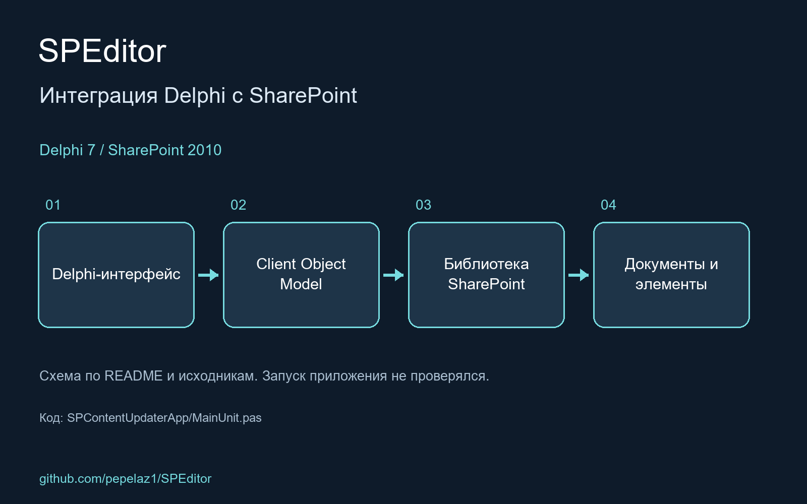

An example of usage SharePoint 2010 Client Object model from Delphi 7

<!-- portfolio-visual:start -->
## Схема работы

Схема подготовлена по README и исходному коду. Запуск приложения не проверялся.
<!-- portfolio-visual:end -->
